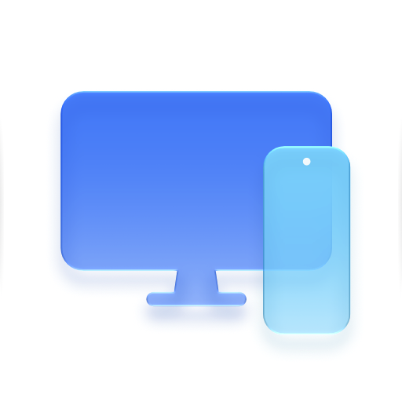
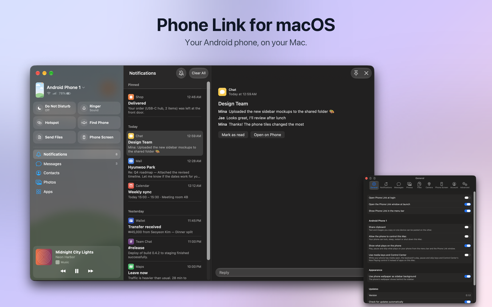
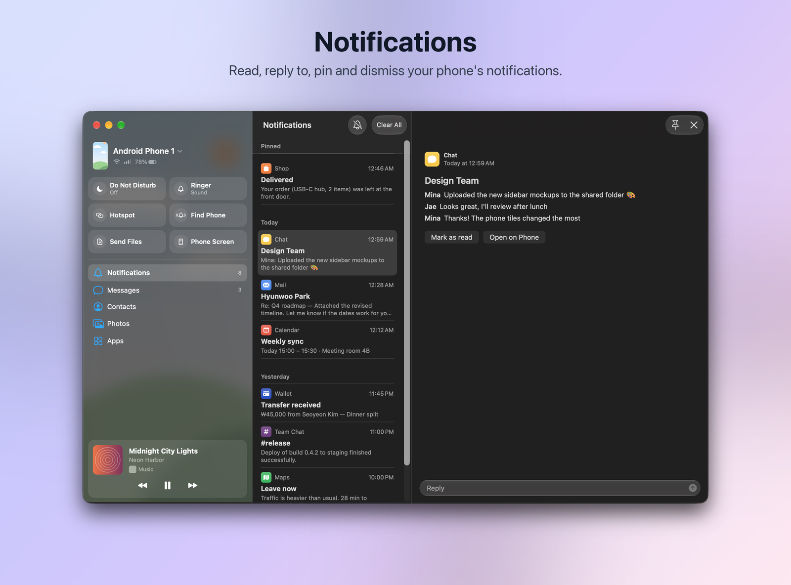
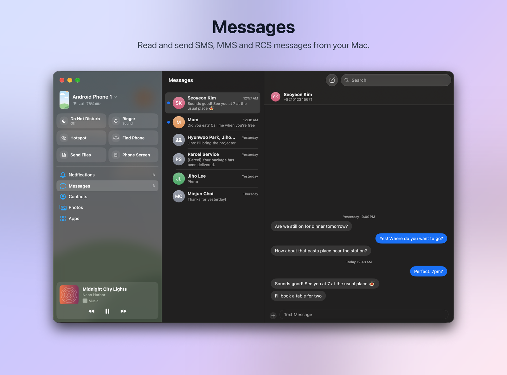
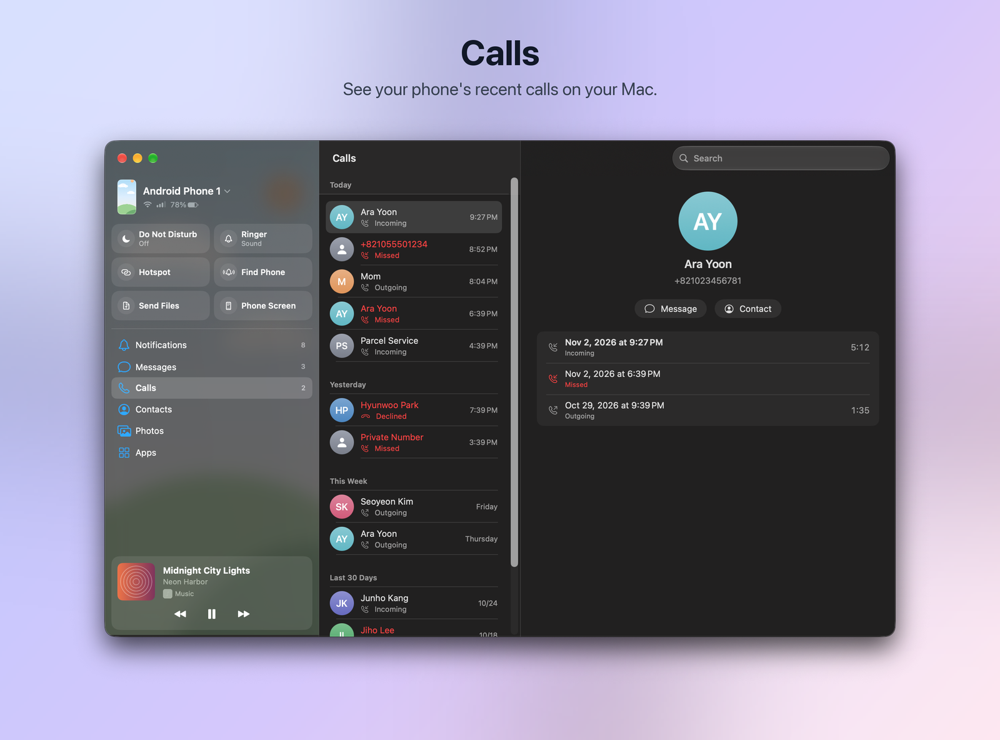
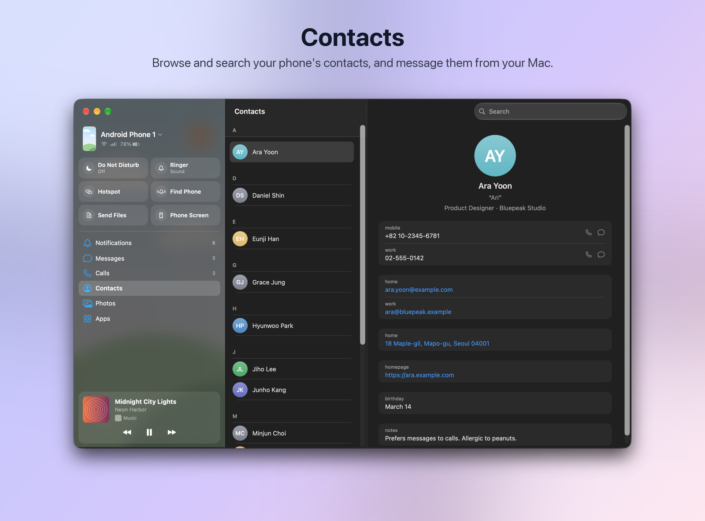
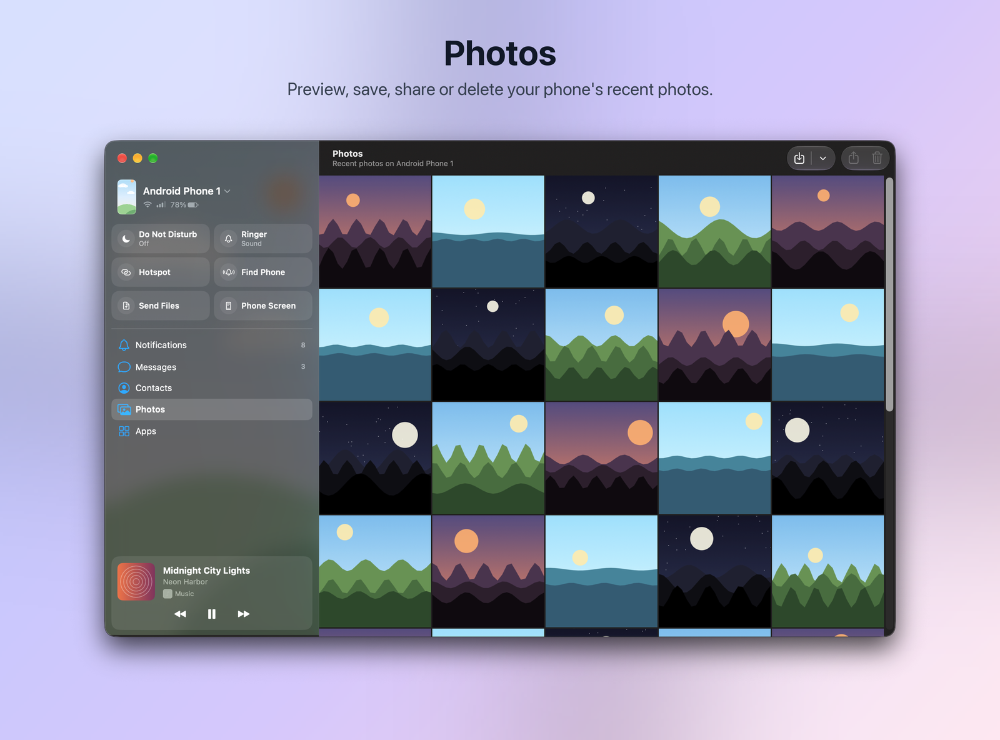
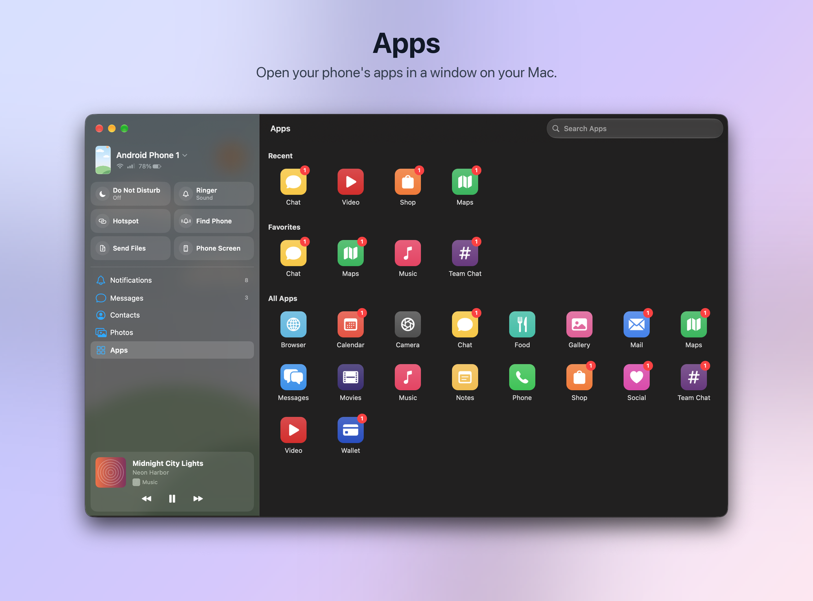
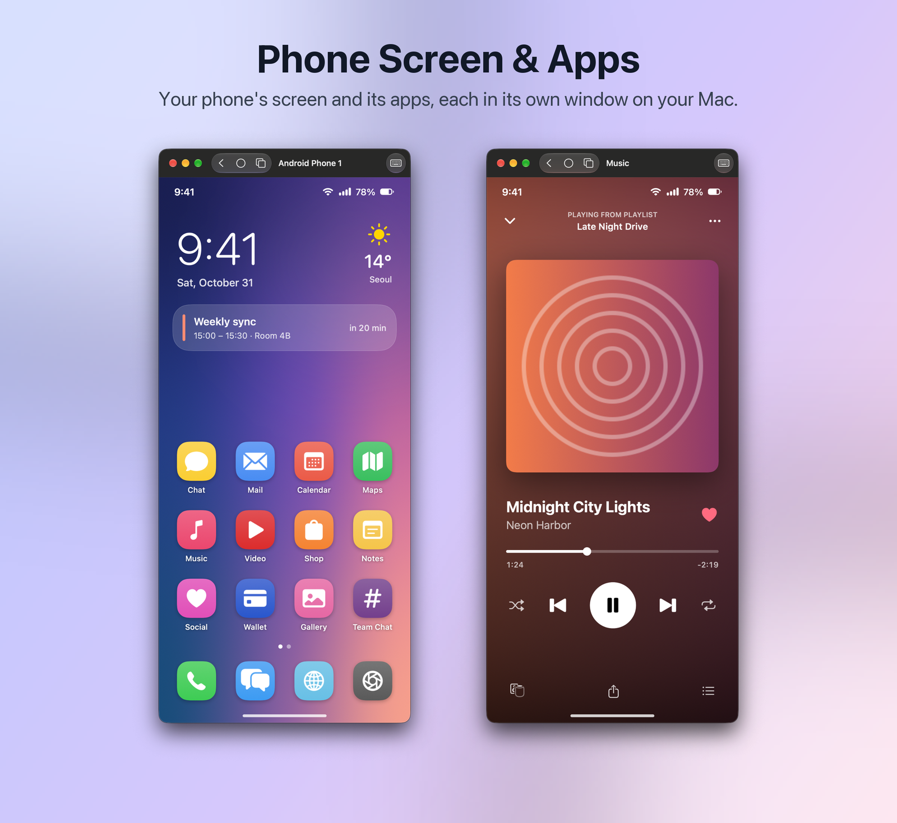
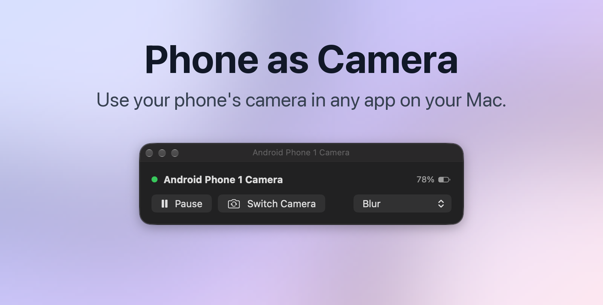

<p align="center">
  
</p>

<h1 align="center">Phone Link for macOS</h1>

<p align="center">Your Android phone, on your Mac.</p>

<p align="center"></p>

Connects through Microsoft's Link to Windows app on your phone.

Phone Link for macOS is an independent project and is neither affiliated with, nor authorized,
sponsored, or approved by, Microsoft Corporation.

## Features

- See your phone's notifications on your Mac and reply to them. You choose which apps can send them.
- Read and send SMS, MMS and RCS messages.
- See your phone's recent calls. Placing and answering calls is not supported.
- Browse your phone's contacts and write to them.
- Browse recent photos.
- Mirror your phone's screen, or one app, in a window.
- Use your phone's camera as a webcam.
- Open your phone's storage in Finder.
- Send files both ways. Files from your phone go to Downloads › Mobile Devices.
- Copy text or an image on one device and paste it on the other.
- Pause or skip what your phone is playing.
- See battery and signal, set Do Not Disturb or the ringer, ring your phone, or join its hotspot from
  the menu bar.
- Let your phone lock, sleep, restart or shut down your Mac. To stop this, turn off Allow the phone
  to control this Mac in Settings.

<table>
  <tr>
    <td></td>
    <td></td>
  </tr>
  <tr>
    <td></td>
    <td></td>
  </tr>
  <tr>
    <td></td>
    <td></td>
  </tr>
  <tr>
    <td></td>
    <td></td>
  </tr>
</table>

More screenshots, including Settings, are in [docs/screenshots.md](docs/screenshots.md).

## Differences from Windows

- You sign in to your Microsoft account in the app's own window.
- Your phone can't wake your Mac or start a connection to it.
- You can see your phone's call history, but you can't place or answer calls on your Mac.

## Install

You need macOS 14 or later and an Android phone with Link to Windows.

Get `PhoneLink-<version>.dmg` from [Releases](https://github.com/nnnlog/phone-link/releases/latest),
open it and drag Phone Link into Applications. Open the app, sign in with your Microsoft account and
pick your phone, or scan the QR code to pair a new one.

The app checks for updates once a day. To change that or get beta versions, go to Settings ›
General › Updates.

Signing out deletes the messages, photos, contacts and notifications kept on your Mac. For a bug report,
save the log from Settings › Advanced › Log. Personal details in the log are redacted.

## Build from source

You need Xcode 26 or later, Rust, [`just`](https://github.com/casey/just) and `python3`.

```bash
git clone https://github.com/nnnlog/phone-link.git
cd phone-link
just dmg
```

This builds `gui/build/PhoneLink-<version>.dmg`. Run `just` to list the other recipes.

To sign with your own team, set it in `gui/Signing.local.xcconfig` as
[`gui/Signing.xcconfig`](gui/Signing.xcconfig) describes. Without a team the app is signed ad-hoc, and
macOS asks for keychain access again after every build.

The camera requires a paid Apple Developer account and a provisioning profile with the System
Extension capability. Everything else works without it.

Builds for other Macs need a team with Developer ID certificates: `just distribute` signs one, and
`just distribute-notarized` also notarizes it.

## Development

`just check` runs the lints and tests, all of which run offline.

| Directory | Contents |
|---|---|
| [`engine/`](engine/README.md) | The Rust core and the `phonelink` command-line tool |
| [`gui/`](gui/README.md) | The SwiftUI app |

## Disclaimer

This software is provided "as is", without warranty of any kind, and you use it at your own risk. The
authors are not liable for any damages arising from its use, including any action Microsoft takes on
your account or devices. See [LICENSE](LICENSE) for the full terms.

## License

Distributed under the MIT License. See [LICENSE](LICENSE) for more information.

Microsoft, Link to Windows and Windows are trademarks of the Microsoft group of companies.
All other trademarks are the property of their respective owners.
