<p align="center">
  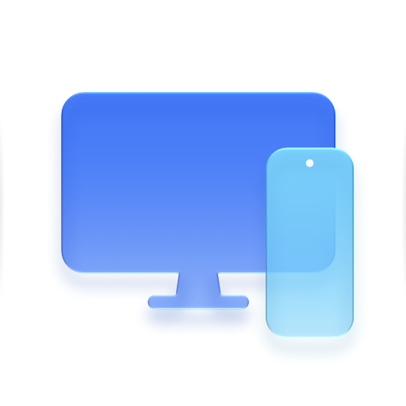
</p>

<h1 align="center">Phone Link for macOS / Linux</h1>

<p align="center">Your Android phone, on your macOS / Linux.</p>

<p align="center">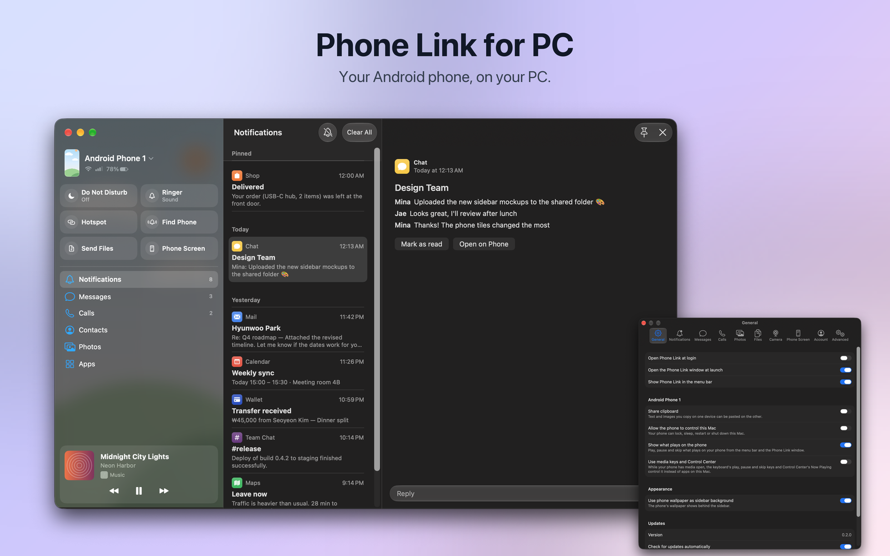</p>

Connects through Microsoft's Link to Windows app on your phone. Runs on macOS and Linux.

Phone Link for macOS / Linux is an independent project and is neither affiliated with, nor
authorized, sponsored, or approved by, Microsoft Corporation.

## Features

- See your phone's notifications on macOS / Linux and reply to them. You choose which apps can send them.
- Read and send SMS, MMS and RCS messages.
- See your phone's recent calls, and place, answer, decline and end calls from macOS / Linux over
  Bluetooth. The call itself stays on your phone: you talk on the phone or a headset connected to it.
  Turn it on in Settings › Calls.
- Browse your phone's contacts and write to them.
- Browse recent photos.
- Mirror your phone's screen, or one app, in a window.
- Use your phone's camera as a webcam.
- Open your phone's storage in your file manager.
- Send files both ways. Files from your phone go to Downloads › Mobile Devices.
- Copy text or an image on one device and paste it on the other.
- Pause or skip what your phone is playing.
- See battery and signal, set Do Not Disturb or the ringer, ring your phone, or join its hotspot from
  the menu bar or system tray.
- Let your phone lock, sleep, restart or shut down your computer. To stop this, turn it off in Settings ›
  General.

<table>
  <tr>
    <td>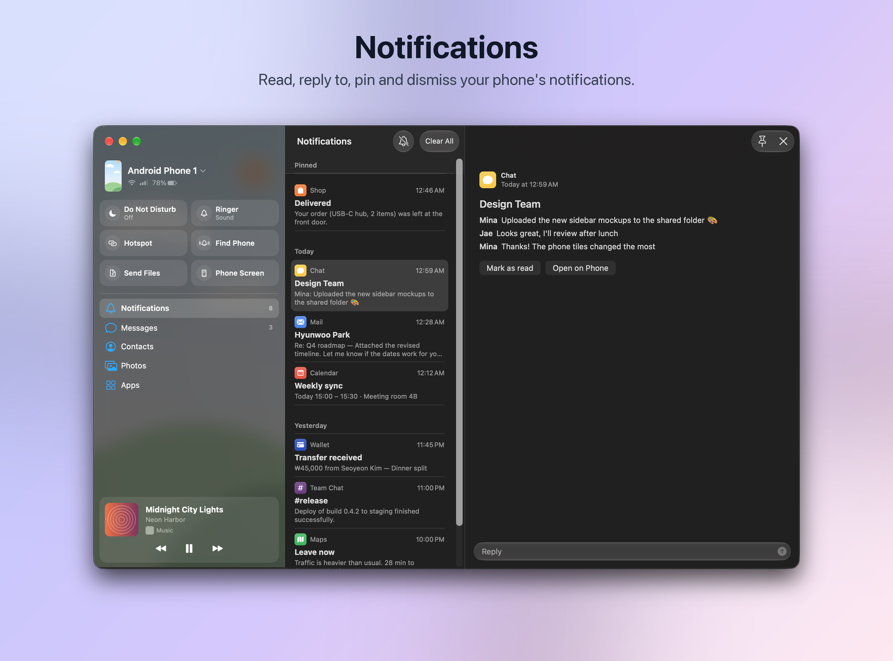</td>
    <td>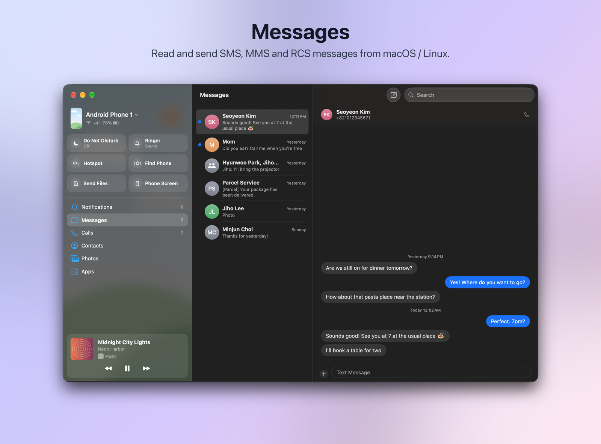</td>
  </tr>
  <tr>
    <td>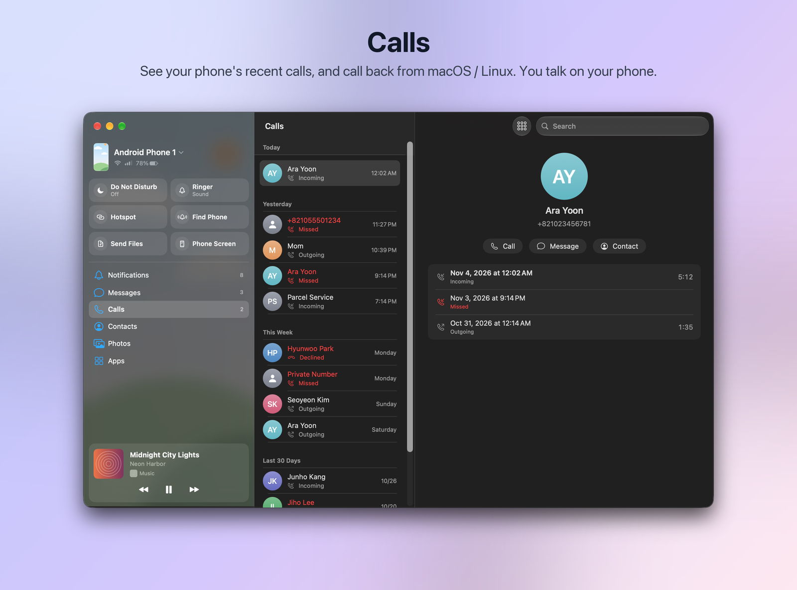</td>
    <td>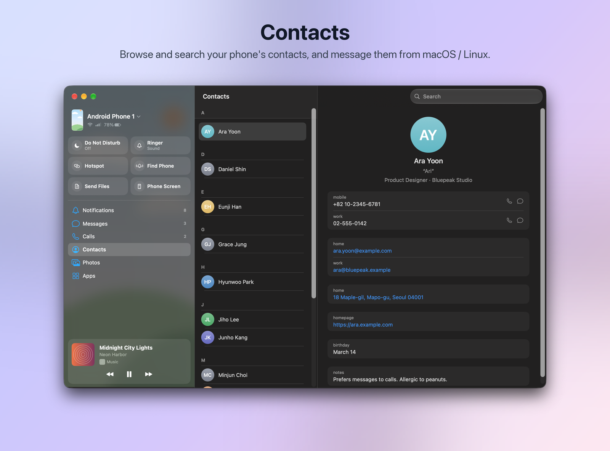</td>
  </tr>
  <tr>
    <td>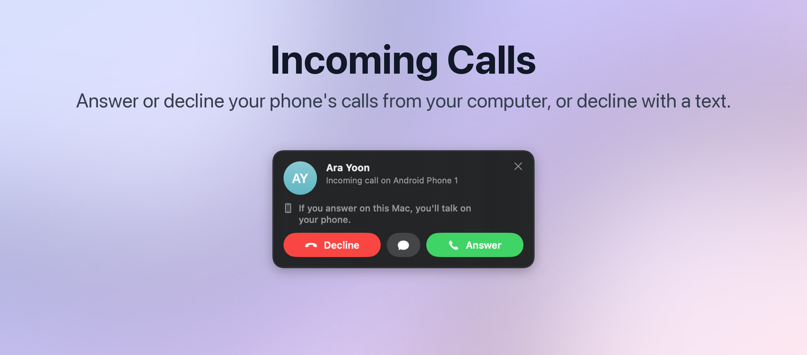</td>
    <td>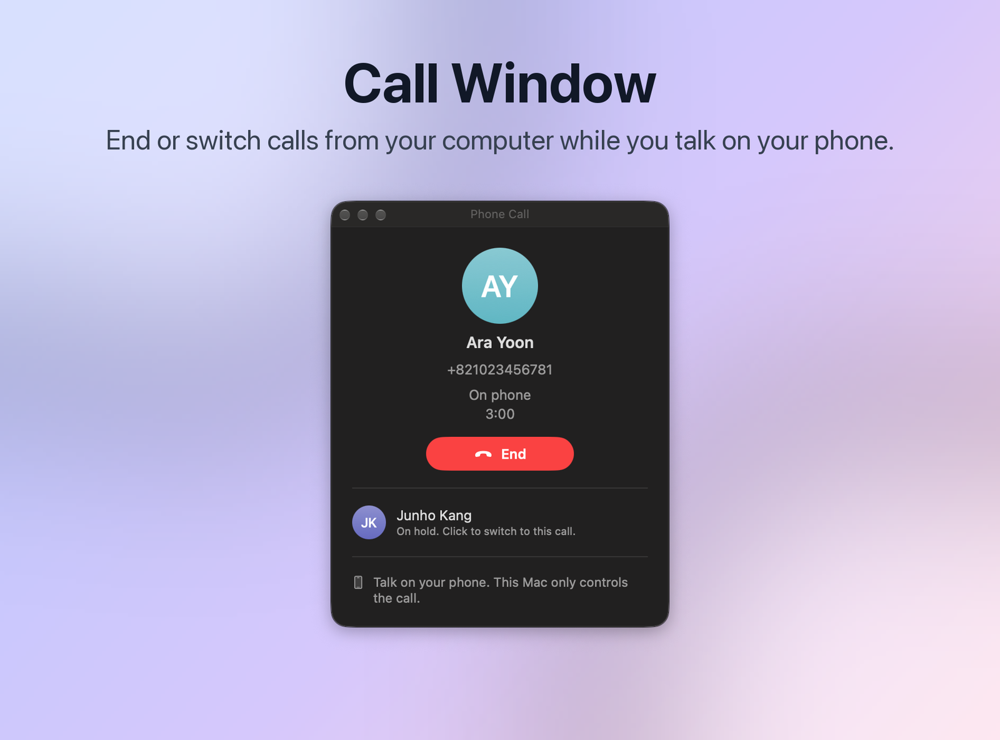</td>
  </tr>
  <tr>
    <td>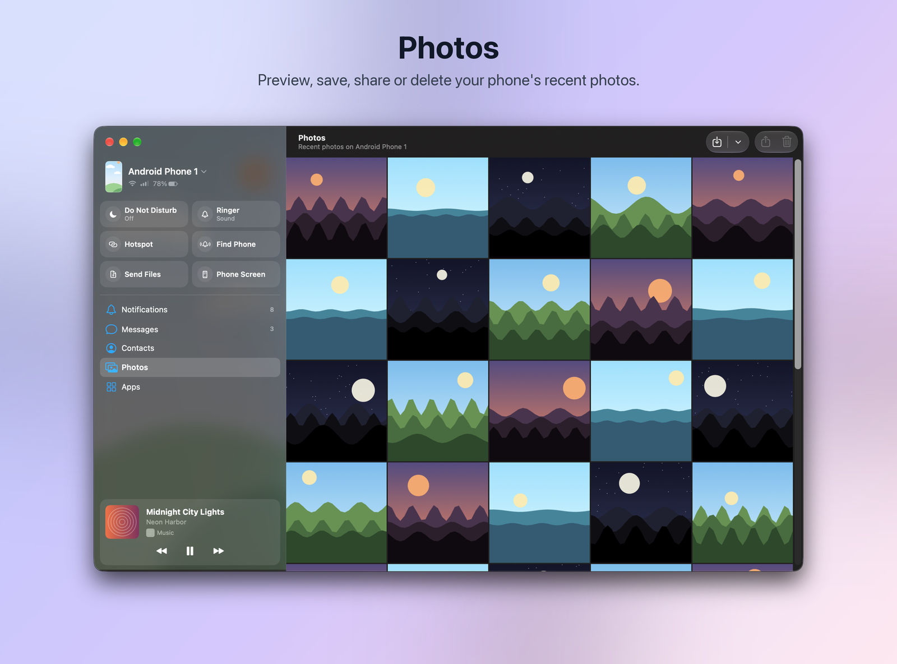</td>
    <td>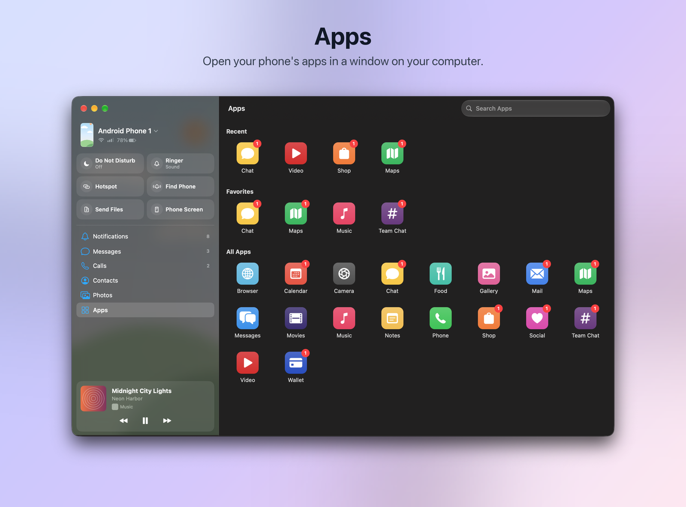</td>
  </tr>
  <tr>
    <td>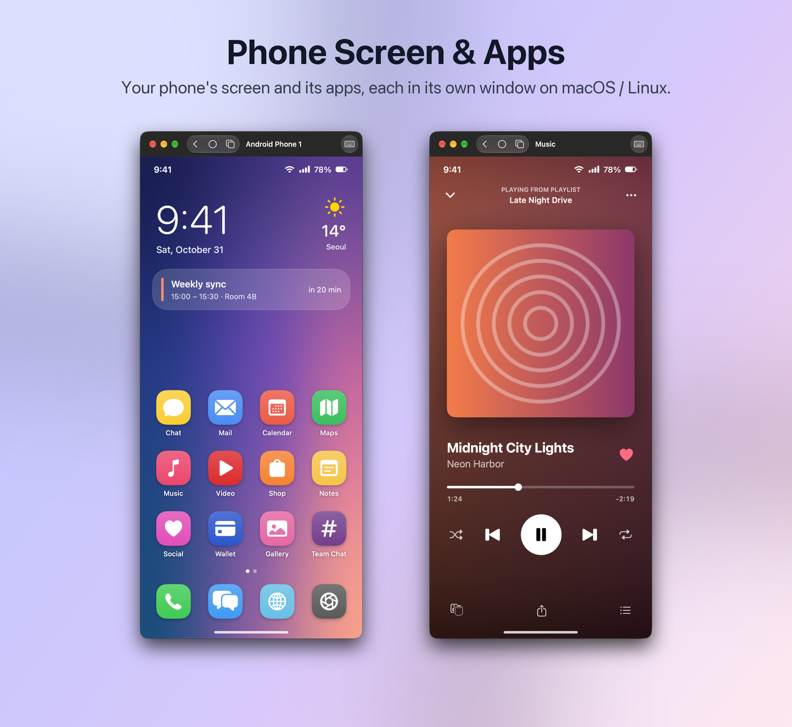</td>
    <td>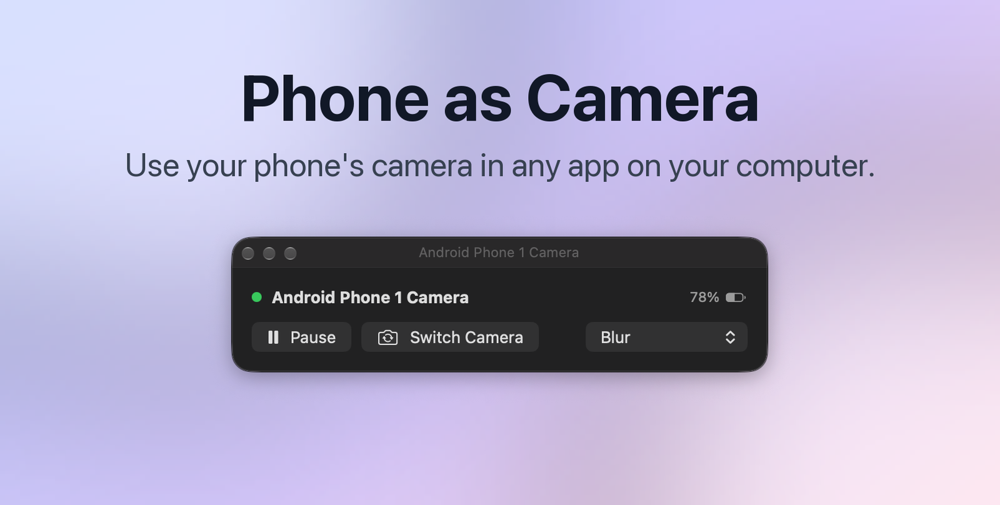</td>
  </tr>
</table>

The screenshots show the macOS app. The Linux app has the same sections in its own window;
[`gui/linux/README.md`](gui/linux/README.md) lists what differs there. More screenshots, including
Settings, are in [docs/screenshots.md](docs/screenshots.md).

## Differences from Windows

- You sign in to your Microsoft account in the app's own window.
- Your phone can't wake your computer or start a connection to it.
- On macOS, calls you place or answer stay on your phone. You talk and listen on the phone, not
  through the Mac's microphone and speakers, because macOS gives the app no voice link to the phone
  over Bluetooth. So there is no mute, hold, keypad or moving a call to the Mac. On Linux, calls you
  place or answer use the computer's microphone and speakers, as on Windows.
- Calls reach your computer only while Phone Link is open.
- In a phone screen window your Mac's keys work as on the Mac: Command-C, -V, -X, -A and -Z, Command
  and Option with the arrow keys and Delete, and Tab. Switching your Mac's input source (Caps Lock,
  Control-Space or the Globe key) switches the phone's input language too. On Linux, the keys go as from
  a Windows PC (Control-C copies, Alt is Alt), and Tab goes too.
- On macOS, a link in a message or a notification opens only when it is a web or an e-mail address.

## Install

You need an Android phone with Link to Windows.

### macOS

You need macOS 14 or later. Get `PhoneLink-<version>.dmg` from
[Releases](https://github.com/nnnlog/phone-link/releases/latest), open it and drag Phone Link into
Applications.

The app checks for updates once a day. To change that or get beta versions, go to Settings ›
General › Updates.

### Linux

Releases hold only the macOS app. Build the `.deb`, `.rpm` or Arch package and install it as
[`gui/linux/README.md`](gui/linux/README.md) describes, which also lists what the app needs (Qt 6, FUSE 3,
a Secret Service provider and more). The package manager updates it.

### First start

Open the app, sign in with your Microsoft account and pick your phone, or scan the QR code to pair a new
one.

Signing out deletes the messages, photos, contacts and notifications kept on your computer. For a bug
report, save the log from Settings › Advanced › Log. Personal details in the log are redacted.

## Build from source

### macOS

You need Xcode 26 or later, Rust, [`just`](https://github.com/casey/just) and `python3`.

```bash
git clone https://github.com/nnnlog/phone-link.git
cd phone-link
just dmg
```

This builds `gui/mac/build/PhoneLink-<version>.dmg`. Run `just` to list the other recipes.

To sign with your own team, set it in `gui/mac/Signing.local.xcconfig` as
[`gui/mac/Signing.xcconfig`](gui/mac/Signing.xcconfig) describes. Without a team the app is signed ad-hoc, and
macOS asks for keychain access again after every build.

The camera requires a paid Apple Developer account and a provisioning profile with the System
Extension capability. Everything else works without it.

Builds for other Macs need a team with Developer ID certificates: `just distribute` signs one, and
`just distribute-notarized` also notarizes it.

### Linux

You need Rust 1.89 or later, `just`, a C++ compiler, CMake, and the development files of Qt 6 and PulseAudio.
In a clone of the repository, `just linux-run` builds and runs the app, and `just linux-deb` or
`just linux-rpm` builds a package. [`gui/linux/README.md`](gui/linux/README.md) has the packages to
install on Ubuntu and the other recipes.

## Development

`just check` runs the engine's lints and tests and the macOS app's tests and translation check, all of
which run offline. On Linux, `just linux-check` runs the Linux app's lints, tests and log-call check.

| Directory | Contents |
|---|---|
| [`engine/`](engine/README.md) | The Rust core and the `phonelink` command-line tool |
| [`gui/mac/`](gui/mac/README.md) | The macOS app (SwiftUI) |
| [`gui/linux/`](gui/linux/README.md) | The Linux app (Rust and Qt/QML) |

## Disclaimer

This software is provided "as is", without warranty of any kind, and you use it at your own risk. The
authors are not liable for any damages arising from its use, including any action Microsoft takes on
your account or devices. See [LICENSE](LICENSE) for the full terms.

## License

Distributed under the MIT License. See [LICENSE](LICENSE) for more information.

Microsoft, Link to Windows and Windows are trademarks of the Microsoft group of companies.
All other trademarks are the property of their respective owners.
